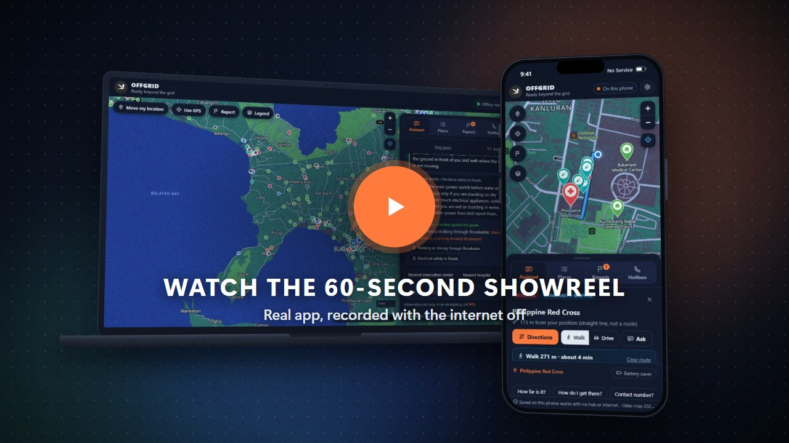
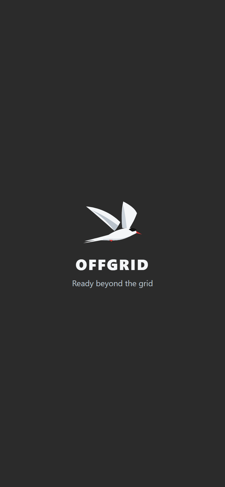

<p align="center">
  
</p>

<h1 align="center">OFFGRID</h1>
<p align="center"><b>Ready beyond the grid.</b><br>
An offline emergency map and AI assistant for all of Batangas, Philippines.</p>

> **Under redevelopment.** OFFGRID is being transformed into a bigger, more reliable system. The published website is an early public preview: features, data and wording may change, and the app updates itself when it does.
> *Binubuo muli ang OFFGRID para maging mas malaki at mas maaasahang sistema. Maagang bersiyon pa lang ang website, kaya maaaring may magbago.*

**Try it now, free, no setup:** [lyle-leif.github.io/OFFGRID](https://lyle-leif.github.io/OFFGRID/) (see [Published website](#published-website-github-pages)).

OFFGRID keeps working when the power and the internet are gone. A laptop runs a small AI model **locally** (no cloud) and acts as a **hub** for the neighborhood. Phones connect to it over local Wi-Fi once, save a full offline copy, and from then on keep working **on their own**, even when the hub is switched off.

> **Information aid only.** OFFGRID does not replace official alerts, emergency services or local authorities. In an emergency, call **911**.
> Facilities come from OpenStreetMap (community-mapped, **not an official government list**). Hotlines come from official sources. Every guide section shows whether it was checked against an official source or is still a draft (see [Data and sources](#data-and-sources)).

---

## Watch

<p align="center">
  <a href="https://youtu.be/O5-LdqrzRaw"></a>
</p>

- **[Showreel on YouTube (60 s, 1080p)](https://youtu.be/O5-LdqrzRaw):** the idea in one minute. The cloud goes down; the laptop's local AI answers a typo'd question; the phone maps, routes and reports; the hub is switched off and the phone keeps going. (Offline copy: [docs/showreel.mp4](docs/showreel.mp4).)
- **[Demo walkthrough (55 s)](docs/demo_video.mp4):** a plain, narrated recording of the same flows, for judges and testers.

Both are made from the real app, recorded with the internet blocked.

---

## Contents
- [Watch](#watch)
- [Published website (GitHub Pages)](#published-website-github-pages)
- [What it does](#what-it-does)
- [Screenshots](#screenshots)
- [How it works](#how-it-works)
- [Setup, step by step](#setup-step-by-step)
  - [A. Laptop hub (one time, while online)](#a-laptop-hub-one-time-while-online)
  - [B. Start OFFGRID](#b-start-offgrid)
  - [C. Put the laptop and the phones on one network](#c-put-the-laptop-and-the-phones-on-one-network)
  - [D. Android phone (Chrome)](#d-android-phone-chrome)
  - [E. iPhone (Safari)](#e-iphone-safari)
  - [F. Check that the phone works without the hub](#f-check-that-the-phone-works-without-the-hub)
  - [G. Troubleshooting](#g-troubleshooting)
- [Using OFFGRID](#using-offgrid)
- [For developers](#for-developers)
- [Data and sources](#data-and-sources)
- [Known limits](#known-limits)

---

## Published website (GitHub Pages)

**https://lyle-leif.github.io/OFFGRID/**: the OFFGRID app as a website, for anyone with a phone and one internet connection. No hub, no certificate, no account.

> **Early preview, under redevelopment.** OFFGRID is being transformed into a bigger, more reliable system. Expect changes; the app updates itself the next time it's opened online.

**What works on the website**
- The offline map of all of Batangas, with 1,758 facilities.
- Emergency guides, with whether each section was checked against an official source.
- Nearest places by road, and walking or driving directions with GPS tracking.
- Official hotlines.
- Tagalog or English (asked the first time; change it in **Settings**, the gear).
- **After the first visit it works with no internet at all**, like a phone whose hub is off.

**Shared situation reports, online:** report a flooded or blocked road, a full or open evacuation center, drinking water, a power outage or a medical need. Everyone using the website sees it within about 20 seconds, and directions go around reported roads. With no signal, your report waits on the phone and is sent when you're back online. Barangay responders log in to verify or remove reports (see [Online reports](#online-reports-cloudflare-free)).

**What the website doesn't have yet** (it works with a local OFFGRID hub, and is part of the redevelopment)
- **AI summaries:** you get the exact guide text, and the app's own answers for places, directions and hotlines.
- **Photos on reports:** the next step.

**Install it on your phone**
1. Open **https://lyle-leif.github.io/OFFGRID/** while you have internet (Wi-Fi is best: about 46 MB is saved).
2. Choose **Tagalog** or **English**.
3. **Android (Chrome):** menu (⋮) → **Install app** (or **Add to Home screen**).
   **iPhone (Safari):** Share button → **Add to Home Screen** → **Add**, then open OFFGRID **from the new icon**. The icon keeps its own copy, so it asks for the language once more.
4. Wait until the bottom of the app says **"Saved on this phone"** (*"Naka-save sa teleponong ito"*). From then on it works offline.

**Good to know**
- **Updates:** when the app is opened with internet, it checks for a newer version and saves it by itself.
- **Privacy:** no sign-up, no tracking, no cookies. Your settings and position stay on your phone. A report you choose to send is shared (the kind, the spot and the time; never names, numbers or photos). Full details: [privacy page](https://lyle-leif.github.io/OFFGRID/privacy.html) ([source](app/static/privacy.html)).
- **Not an official service:** OFFGRID is an information aid. Facility details are community-mapped (OpenStreetMap) and can be wrong or out of date. **In an emergency, call 911** and follow official announcements.
- **Free:** free to use, and hosted for free on GitHub Pages.
- **Problems or ideas:** [open an issue](https://github.com/lyle-leif/OFFGRID/issues).

---

## What it does

| Feature | What you get |
|---|---|
| **Offline map** | Street-level map of all of Batangas with 1,758 facilities: evacuation centers, hospitals, clinics, pharmacies, police, fire, rescue, town halls. Light and dark themes. |
| **Local AI assistant** | Answers from saved emergency guides. The **exact guide text comes first**; then the local AI (Qwen 2.5, 3B, via Ollama) adds a short summary. Code checks every number, phone number and name in that summary against the guide, and drops the summary if anything doesn't match. |
| **Tagalog or English** | The first time it opens, OFFGRID asks: Tagalog or English. Buttons, messages and the app's own answers (nearest places, directions, report summaries) follow that choice, on the laptop and on the phone with no hub. Change it any time in **Settings** (the gear). Guides and hotlines stay in English, word for word from the official sources. |
| **Understands typos and Taglish** | "how do i stop bleding", "is it safe to wlak thru flood water", "saan ang pinakamalapit na ospital" all work. Spelling is fixed by code before the search, on the laptop and on the phone. |
| **Nearest places, by road** | "Nearest hospital?", "Saan may botika?", "How far is it?". Answered from the map data, never invented by the AI. |
| **Offline directions** | Walking or driving routes with turn-by-turn steps and GPS tracking, computed on the device. Routes **steer around roads people reported as flooded or blocked**. |
| **Situation reports** | Anyone can report a flooded or blocked road, a full or open evacuation center, drinking water, a power outage or a medical need. Reports are labelled *unverified*, *confirmed* or *verified by a responder*, and expire on their own. No names or phone numbers are collected. |
| **Hotlines** | Official numbers: national, Batangas PDRRMO, Batangas City, Lipa City. |
| **Battery saver** | Skips the AI and shows the guide text only. It turns on by itself at 20% battery when not charging. |
| **Works with the hub off** | Each phone keeps the map, guides, hotlines, search, nearest places and the router (about 46 MB). Only the AI summary and live report sharing need the hub. |

---

## Screenshots

All screenshots come from the real app, taken by [`tools/screenshots.mjs`](tools/screenshots.mjs) with the internet blocked.

**Laptop (the hub)**

<table>
  <tr>
    <td align="center" valign="top" width="50%">
      <br>
      <b>Local AI, dark map</b><br>
      <sub>Guide text first, then a checked AI summary</sub>
    </td>
    <td align="center" valign="top" width="50%">
      <br>
      <b>Directions, light map</b><br>
      <sub>A 2.5 km walk with turn-by-turn steps</sub>
    </td>
  </tr>
</table>

**Phone**

<table>
  <tr>
    <td align="center" valign="top" width="25%">
      <br>
      <b>Launch</b><br>
      <sub>Opens on the tern, then the map</sub>
    </td>
    <td align="center" valign="top" width="25%">
      <br>
      <b>Home</b><br>
      <sub>Full-screen map and a bottom panel</sub>
    </td>
    <td align="center" valign="top" width="25%">
      <br>
      <b>Assistant</b><br>
      <sub>“how do i stop bleding” (typo on purpose)</sub>
    </td>
    <td align="center" valign="top" width="25%">
      <br>
      <b>Nearest, in Filipino</b><br>
      <sub>Hospitals by road distance</sub>
    </td>
  </tr>
  <tr>
    <td align="center" valign="top" width="25%">
      <br>
      <b>Directions</b><br>
      <sub>Walking route worked out on the device</sub>
    </td>
    <td align="center" valign="top" width="25%">
      <br>
      <b>Situation reports</b><br>
      <sub>A flooded road reported by another phone</sub>
    </td>
    <td align="center" valign="top" width="25%">
      <br>
      <b>Hub switched off</b><br>
      <sub>Still answers: “On this phone”</sub>
    </td>
    <td align="center" valign="top" width="25%">
      <br>
      <b>Hub setup page</b><br>
      <sub>Certificate and install steps</sub>
    </td>
  </tr>
</table>

The setup page shows `127.0.0.1` because the shot was taken on the laptop; on a phone it shows the laptop's Wi-Fi address.

---

## How it works

```
                 LAPTOP  =  HUB  (optional)                         PHONES
   ┌──────────────────────────────────────────────┐   local Wi-Fi   ┌───────────────────────────┐
   │ FastAPI server (Python)                      │ ◀────────────▶ │ OFFGRID app (installed     │
   │  • local AI: Ollama + qwen2.5:3b (no cloud)  │   https :8443   │ from the hub, works alone) │
   │  • guide search (BM25) + spelling fixer      │                 │  • map + 1,758 places      │
   │  • code check of every AI summary            │  setup page     │  • guides + same search    │
   │  • road router (A*), avoids reported roads   │   http :8080    │  • router on the phone     │
   │  • situation reports (SQLite)                │                 │  • reports outbox + copy   │
   └──────────────────────────────────────────────┘                 └───────────────────────────┘
        No internet needed after setup.                 Hub off?  The phone keeps working.
```

- **Order of an answer:** location questions ("nearest hospital", "how far") and current-conditions questions ("is the road flooded?") are answered from data, never by the AI. Direction questions go to the router. Everything else searches the guides; if nothing matches, OFFGRID says so instead of guessing. The AI only ever sees the guide sections shown on screen.
- **The phone engine** in `app/static/offline/` is a JavaScript port of the hub's search, spelling fixer, answers and router. Parity tests check that it gives the same answers as the hub.
- **Reports are shared only through the hub.** A phone that is offline keeps its reports in an outbox and sends them when it next reaches the hub.

---

## Setup, step by step

You need:
- **Laptop (hub):** Windows 10 or 11, about 8 GB RAM, about 3 GB free disk (most of it is the AI model). Wi-Fi, or a router shared with the phones.
- **Phones:** Android 8 or newer with Chrome (about 60 MB free, 2 GB RAM), or an iPhone with Safari.
- **Internet only once,** on the laptop, to install the software and download the AI model.

### A. Laptop hub (one time, while online)

1. **Install the tools:**
   - [Python 3.12 or newer](https://www.python.org/downloads/). Tick **"Add python.exe to PATH"** in the installer.
   - [Git for Windows](https://git-scm.com/download/win). OFFGRID uses its `openssl` to make the hub's certificate.
   - [Ollama](https://ollama.com/download), which runs the local AI.
2. **Copy the OFFGRID folder** to the laptop, for example to the Desktop.
3. **Open PowerShell in that folder:** in File Explorer, open the folder, click the address bar, type `powershell` and press Enter.
4. **Create the Python environment and install the packages:**
   ```powershell
   python -m venv .venv
   .venv\Scripts\python -m pip install -r requirements.txt
   ```
5. **Download the AI model** (about 1.9 GB):
   ```powershell
   ollama pull qwen2.5:3b
   ```
6. **Optional check:** `.venv\Scripts\python -m pytest -q` should end with "passed".

From here on, the laptop needs **no internet**.

### B. Start OFFGRID

| You want | Double-click | Then |
|---|---|---|
| Use it on **this laptop only** | `start.bat` | The app opens at http://127.0.0.1:8000. Close the "OFFGRID server" window to stop. |
| Let **phones** connect (hub mode) | `start_hub.bat` | Two "OFFGRID hub" windows open (https 8443 for phones, http 8080 for the setup page). Close both to stop. |

When `start_hub.bat` is ready, it prints what each phone needs:

```
[OK] Hub running. On each phone, join this laptop's Wi-Fi or hotspot and open:
       http://192.168.1.26:8080/setup

     Certificate code the phone must show (compare the first 16 characters):
       874D CAAF E982 5344
```

Your address and code will be different. Keep this window where people can see it. The status pill in the app turns green, **Offline-ready**, once the AI model is loaded.

- The AI is optional in hub mode. If Ollama isn't running, answers show the guide text without the AI summary.
- **Responder PIN:** the "OFFGRID hub - phones (https 8443)" window prints `responder PIN for this session: ......`. Give it only to barangay responders; it lets them verify or remove reports. To choose your own PIN, set `BB_RESPONDER_PIN` before starting.

### C. Put the laptop and the phones on one network

Use **one** of these:

1. **Same Wi-Fi router** (home, barangay hall, school). It works even when the router has no internet, as long as it has power.
2. **The laptop's Mobile Hotspot:** Windows **Settings → Network & internet → Mobile hotspot → On**. Phones join that network; the setup address is then usually `http://192.168.137.1:8080/setup`.
3. **A phone's hotspot:** the laptop and the other phones join it. Restart `start_hub.bat` afterwards so it prints the new address.

The first time, **Windows Firewall asks whether Python may use the network.** Allow it. If the laptop's network is marked *Public*, the phones may not be able to reach it. Either set that network to **Private** (Settings → Network & internet → Wi-Fi → your network → Private network) or allow Python on Public networks too.

### D. Android phone (Chrome)

Do this once per phone, while near the hub. It takes about 2 minutes.

1. Connect the phone to the same network as the laptop (step C).
2. Open **Chrome** and type the setup address the hub printed, for example `http://192.168.1.26:8080/setup`.
3. Tap **Download certificate**. Check that the code on the page matches the code on the laptop screen.
4. **Install the certificate:** Settings → **Security** (or Security & privacy) → More security settings → **Encryption & credentials** → **Install a certificate** → **CA certificate** → Install anyway, and choose `offgrid-ca.crt` from Downloads.
   - Android 8–9: Settings → Security & location → Encryption & credentials → **Install from storage**.
   - Android may ask you to set a screen lock first. That is normal.
5. Back on the setup page, tap **Open https://…:8443/**. The OFFGRID app opens with no security warning and asks **Tagalog or English**; choose one (it can be changed later in Settings).
6. In Chrome's menu (⋮), tap **Install app** (or **Add to Home screen**).
7. Wait until the bottom of the app says **"Saved on this phone: works with no hub or internet."** (in Tagalog: *"Naka-save sa teleponong ito"*). About 46 MB is saved.
8. From now on, open OFFGRID **from its home-screen icon**.

**Why the certificate?** Phones allow offline copies and GPS only on secure (https) pages. The hub makes its own small certificate authority. It is limited to private network addresses, so it cannot be used to fake real websites. You can remove it later in the same Settings screen.

### E. iPhone (Safari)

1. Connect the iPhone to the same network as the laptop (step C).
2. Open **Safari** (not Chrome) and type the setup address, for example `http://192.168.1.26:8080/setup`.
3. Tap **Download certificate**, then **Allow**. Check that the code matches the laptop screen.
4. Two settings, **both needed:**
   1. Settings → **Profile Downloaded** (or General → VPN & Device Management) → **Install**.
   2. Settings → General → About → **Certificate Trust Settings** → turn on **OFFGRID Hub**.
5. Back in Safari, tap **Open https://…:8443/**.
6. Tap the **Share** button → **Add to Home Screen** → **Add**.
7. Open OFFGRID **from the new icon** (not from Safari), choose **Tagalog or English**, and wait for **"Saved on this phone"** (*"Naka-save sa teleponong ito"*).

### F. Check that the phone works without the hub

1. On the laptop, close the two "OFFGRID hub" windows (or switch the laptop off).
2. On the phone, open OFFGRID from the home-screen icon. The pill now says **On this phone**.
3. Try these:
   - Ask "nearest evacuation center". You should get a list with road distances.
   - Ask "how do I stop bleeding". You should see the first-aid guide text.
   - Open **Places**, pick a place, tap **Directions**. A route should appear on the map.
4. Start the hub again later. The phone shares its queued reports and picks up new ones automatically.

### G. Troubleshooting

| Problem | What to do |
|---|---|
| **The phone can't open the setup address** | Check the hub windows are open and the address is exactly what `start_hub.bat` printed (`http`, port `8080`). Make sure both devices are on the same network. Allow Python in Windows Firewall (step C). Some routers block devices from seeing each other ("AP isolation" or "client isolation", common on guest Wi-Fi); use the laptop's Mobile Hotspot or a phone hotspot instead. Antivirus firewalls can also block Python; allow it there too. |
| **"Your connection is not private"** | The certificate isn't installed or trusted yet. Repeat step D4 (Android) or both settings in step E4 (iPhone). |
| **No "Install app" in Chrome's menu** | Open the **https** address (port 8443), not the setup page. Reload once after the certificate is installed. |
| **Stuck on "Saving…"** | Stay near the hub with the app open until it says "Saved on this phone". About 46 MB is downloaded. |
| **"Use GPS" finds nothing** | With Wi-Fi off, the phone has only the satellites: the first fix can take a minute. Step outside or near a window and wait while it says "Locating…". If it says location is off: on iPhone, **Settings → Privacy & Security → Location Services → Safari Websites → While Using the App**, and turn on **Precise Location**; on Android, allow Location for Chrome. You can always tap **Move my location** and then the map instead. |
| **The laptop's address changed** | Restart `start_hub.bat`. It renews the hub certificate for the new address and prints it. The phone keeps its certificate, but needs to open and install the app from the new address. |
| **"AI offline" or no AI summary** | Start Ollama (the tray app, or `ollama serve`). Answers still work from the guide text. |
| **"Model missing"** | While online: `ollama pull qwen2.5:3b`. |
| **The first answer is slow** | The model is loading into memory. Wait for **Offline-ready** and close other heavy apps. |

---

## Using OFFGRID

- **First open:** choose **Tagalog** or **English**. It is asked once per phone (and once more inside an iPhone home-screen app, which keeps its own settings).
- **Top bar:** the status pill (*Offline-ready*, *AI warming up*, *AI offline*, or *On this phone* when there is no hub), **Settings** (the gear: change the language; the app restarts in it, keeping your position, theme and waiting reports) and the light/dark toggle.
- **Map buttons:** *Move my location* (tap the map where you are), *Use GPS* (zooms to you), *Report*, *Legend*. The compass appears when the map is rotated; tap it to face north again.
- **Panel tabs** (a floating card on the laptop, a bottom sheet on phones):
  - **Assistant:** ask anything. Tap a suggestion chip or type. *New topic* clears the follow-up context. *Battery saver* skips the AI.
  - **Places:** search and filter facilities, tap one for details, **Directions** (Walk or Drive), or **Ask** about it.
  - **Reports:** **Report something**, choose what, tap the spot on the map. Others can tap **Still true** or **Not true**. *I'm a responder* takes the hub PIN.
  - **Hotlines:** official emergency numbers.

**Questions to try**

| Ask | You get |
|---|---|
| "Nearest evacuation center" / "saan ang pinakamalapit na ospital?" | The 3 nearest by road, with Show and Route buttons |
| "How do I get there?" (after picking a place) | Turn-by-turn directions |
| "Is it safe to walk through floodwater?" | Flood-safety guide text plus a checked AI summary |
| "What should I pack for a baby when evacuating?" | When to evacuate, plus the go-bag section for infants |
| "Is the road flooded?" / "Any reports near me?" | Current situation reports, with their trust labels and age |
| "What does signal no. 3 mean?" | PAGASA wind signals (checked against PAGASA) |
| "Ano gagawin kapag may lindol?" / "What does Taal alert level 3 mean?" | Drop, cover and hold / Taal alert levels (checked against PHIVOLCS) |
| "Batangas PDRRMO number" | Official hotline |

The full question bank, with what answers each one, is in [data/suggested_questions.md](data/suggested_questions.md).

**Report kinds and how long they last:** road flooded or blocked (2 h); evacuation center full or open (6 h); drinking water (6 h); power out (6 h); medical need (2 h). A confirmation restarts the clock, up to 3 lifetimes. A report gets the *confirmed* label after 2 confirmations, and is hidden when disputes reach confirmations + 2. Limits: 10 reports per phone and 30 per network address per hour.

---

## For developers

**Tests**
```powershell
.venv\Scripts\python -m pytest -q          # Python and Node parity tests; no Ollama needed (the AI is mocked)
node tools\e2e_offline.mjs                 # headless Edge: save the copy, stop the hub, check everything still works
.venv\Scripts\python tools\check_questions.py        # 267-question bank -> docs/question_report.md
.venv\Scripts\python tools\check_questions.py --ai --sample 40   # also check real AI summaries
node tools\screenshots.mjs                 # retake the README screenshots (Ollama running)
```

**Showreel** (`tools/showreel/`, see `timeline.mjs` for every cut and cue)
```powershell
node tools\showreel\capture.mjs            # record real-app footage (Ollama running, internet blocked)
node tools\showreel\build.mjs              # soundtrack -> 3,600 frames -> docs/showreel.mp4 (about 11 min)
```

**After changing data or app code,** rebuild the phone pack so phones download the new copy next time they reach the hub:
```powershell
.venv\Scripts\python tools\build_phone_pack.py
```
After changing answer logic, also run `.venv\Scripts\python tools\make_parity_fixtures.py`.

**Publishing the website (GitHub Pages).** The website is the same app in "website mode": `tools/build_site.py` copies `app/static` and adds `<meta name="offgrid-mode" content="site">` to `index.html`. `app/static/mode.js` reads it (`SITE`), and the app then skips the hub entirely (no `/api`; answers, places and routes come from the phone engine; places and hotlines from `pack/locations.json` and `pack/hotlines.json`). All app paths are relative to `mode.js`'s `BASE`, so the same files work at `/` (hub) and `/OFFGRID/` (website); `tests/test_site.py` fails on any `"/..."` path.
- To publish an update: run `tools/build_phone_pack.py`, commit, and push to `main`. `.github/workflows/pages.yml` builds and deploys when `app/static/**` changes (or use **Run workflow** in the Actions tab).
- One-time setup: repo **Settings → Pages → Source: GitHub Actions**.
- `node tools/site_check.mjs` checks the website build end to end: it serves the site under `/OFFGRID/` like GitHub Pages, installs it in headless Edge, turns the server off, and checks answers, directions, Tagalog, the privacy page, updates, and that no `/api` call is ever made.
- **Cost: nothing.** GitHub Pages and Actions are free for public repositories. The workflow uses only the standard `ubuntu-latest` runner (never a paid "larger runner"), no Git LFS and no custom domain. GitHub's 100 GB/month download limit for Pages is a soft limit (about 2,000 first installs); going over doesn't charge anything.

**Online reports (Cloudflare, free).** <a id="online-reports-cloudflare-free"></a> The website shares situation reports over the internet through a small service in [cloud/](cloud): a Cloudflare Worker with a D1 (SQLite) database, on Cloudflare's **free plan, which needs no card**. It follows the hub's report rules exactly: the same kinds and lifetimes, trust labels, one vote per phone, hiding and purging (`tests/test_cloud.py` replays the same steps on both and compares), and answers on the same `/api/reports` paths, so the app works with it unchanged.
- **Real time:** the website refreshes reports every 20 s while it's on screen, and at once after posting or voting. A report made offline waits on the phone and is sent when it's back online.
- **Road reports** are snapped to the road on the phone (the cloud has no road network); the cloud checks the road id, and that center reports name a real evacuation center.
- **Responders log in with personal accounts** (no shared PIN online). Each login, verify and remove goes into an audit log.
- **Live at** https://offgrid.offgrid-batangas.workers.dev/ (set up 2026-10-29).
- **One-time setup** (done; for a new account, about 10 minutes, nothing to pay):
  1. Make a free Cloudflare account at https://dash.cloudflare.com/sign-up (email only; **don't add a card**).
  2. `npx wrangler@4.150.0 login` (approve in the browser that opens).
  3. `node tools/cloud_admin.mjs setup`: it creates the database, applies [cloud/schema.sql](cloud/schema.sql), publishes the Worker at a free `*.workers.dev` address and writes it to `cloud/site.json`. (If Cloudflare asks you to pick a free workers.dev subdomain, do it in the dashboard and run `setup` again.)
  4. Add responders: `node tools/cloud_admin.mjs add "Juan Dela Cruz"`. It prints the password **once**; give it privately. Also `reset`, `disable`, `enable`, `list`, and `log` (the audit log).
  5. Commit and push `cloud/site.json` (and `cloud/wrangler.toml`): the website republishes with online reports switched on.
- **After a data or rule change:** `tools/build_phone_pack.py` also rewrites `cloud/src/data.js`; publish it with `node tools/cloud_admin.mjs deploy`.
- **Testing without Cloudflare:** `node cloud/local/server.mjs` runs the same Worker on this computer (Node's built-in SQLite). `node tools/site_check.mjs --cloud` checks the website with it end to end: another phone's report arrives within 20 s and directions go around it, this phone's reports (also queued offline) arrive, and a responder login, verify and audit entry all work.
- **Cost: nothing.** The Workers free plan allows about 100,000 requests a day; refreshing only while the app is on screen keeps a barangay's use far below that. If the limit were ever reached, requests would simply fail until the next day: phones keep working from their saved copy and keep reports in their outbox. **Nothing is ever charged** unless someone upgrades the account and adds a card. The setup uses no paid features (no custom domain, no R2 storage, no paid add-ons); `tests/test_cloud.py` checks that.

**Interface language.** Every sentence the app shows or writes itself lives in `app/static/lang/en.json` and `tl.json` (flat keys, `{placeholders}`, plurals as `key_one`/`key_other`). The interface, the phone engine and the hub all read these same files, so their wording can't drift; `tests/test_i18n.py` checks both files have the same keys and placeholders and that every key the code uses exists. After changing Tagalog text, run `.venv\Scripts\python tools\make_translation_review.py` to refresh [docs/translation_review.md](docs/translation_review.md), the side-by-side list for a native speaker to check. To add a language: a new `lang/<id>.json` with the same keys, plus an entry in `LANGS` in `app/static/i18n.js` and `app/services/i18n.py`.

**Where things are**

| Path | What |
|---|---|
| `app/main.py`, `app/config.py` | FastAPI app and settings (env overrides: `BB_MODEL`, `BB_THRESHOLD`, `BB_TOP_K`, `BB_REPORTS_DB`, `BB_RESPONDER_PIN`, …) |
| `app/routes/` | `assistant.py` (answers), `directions.py`, `reports.py`, `locations.py`, `setup.py` |
| `app/services/` | `retrieval.py` (BM25 + synonyms), `normalize.py` (spelling fixer), `intents.py`, `verify.py` (AI summary check), `routing.py` (A*), `reports.py`, `llm.py` (Ollama) |
| `app/static/` | The web app (vanilla JS, MapLibre, PMTiles) and `sw.js`, the offline copy |
| `.github/workflows/pages.yml`, `tools/build_site.py` | The free website: build and publish to GitHub Pages |
| `cloud/`, `tools/cloud_admin.mjs` | Online reports for the website: Cloudflare Worker + D1 (free plan), responder accounts |
| `app/static/offline/` | The phone engine: search, spelling fixer, answers, router, reports |
| `data/` | Facilities, guides, roads, question bank |
| `tools/` | Imports, phone pack, certificates, map styles, demo, showreel and screenshot tools |
| `tests/` | pytest suite, question bank, JS parity tests |

**API**

| Endpoint | Purpose |
|---|---|
| `GET /api/health` | Server, Ollama and model status, report count |
| `GET /api/locations`, `GET /api/locations/{id}` | Facility records |
| `POST /api/assistant/ask` | `{question, location_id?, previous?, from_pos?, travel_mode?, use_ai?, lang?}` → NDJSON stream (`lang`: `en` or `tl`, for the app's own sentences) |
| `GET /api/route` | `from_lat, from_lng, to_id, mode=walk\|drive, avoid_reports=true, lang=en\|tl` → line, steps, distance, time, avoided reports |
| `GET /api/hotlines` | Hotline sections |
| `GET/POST /api/reports`, `POST /api/reports/{id}/vote` | List, post and confirm/dispute situation reports |
| `POST /api/reports/responder`, `POST /api/reports/{id}/verify`, `DELETE /api/reports/{id}` | Responder sign-in (PIN), verify, remove |
| `GET /setup`, `GET /offgrid-ca.crt` | Phone setup page (`?lang=tl\|en`, otherwise the browser's language) and the hub certificate |

---

## Data and sources

### Facilities: `data/locations.json` (1,758 records, all of Batangas)
Imported from **OpenStreetMap** (© OpenStreetMap contributors, ODbL) on 2026-10-09 by `tools/import_osm.py`:

| Type | Count | OSM tags |
|---|---|---|
| Evacuation center | 183 | `evacuation_center=yes` / `emergency_shelter=yes` (schools, BatStateU, town halls, gyms) |
| Pharmacy | 317 | `amenity=pharmacy`, `shop=chemist` |
| Clinic / health center | 256 | `amenity=clinic`/`doctors`, `healthcare=centre` |
| Hospital | 101 | `amenity`/`healthcare=hospital` |
| Town / city hall | 68 | `amenity=townhall` (not barangay) |
| Police / fire | 85 / 39 | `amenity=police` / `fire_station` |
| Rescue / DRRM | 14 | Ambulance and rescue stations, DRRM offices |
| Barangay hall | 467 | `townhall:type=barangay/village` (hidden by default) |
| Market / grocery | 228 | Supermarkets, groceries, marketplaces (hidden by default) |

- **These are not official designations.** Evacuation centers show "Confirm with your barangay or MDRRMO".
- Point/outline duplicates were merged (26), and unnamed objects dropped (34).
- **Gaps:** OSM has no drinking-water points mapped in this area. Sari-sari stores (1,800+) are excluded on purpose.
- To refresh, while online: `.venv\Scripts\python tools\import_osm.py`.

### Hotlines: `data/guides/hotlines.md`
Every number is copied from an official source, named under each section in the app:
- **National (911, NDRRMC, PNP, BFP, PAGASA, Red Cross):** Executive Order No. 56 / DILG for 911 (it replaced PNP Patrol 117), the government's [PH Emergency Hotlines](https://ehotlines.e.gov.ph/) directory, and [redcross.org.ph](https://redcross.org.ph/contact-us/).
- **Batangas PDRRMO, Batangas City, Lipa City:** their official websites (2026-10-09).
- **Calaca City, Nasugbu, Lemery, San Juan, Alitagtag, Balete, Talisay:** each town's official website (2026-10-27). Office lines only.

Other towns have no verified list yet; the app says so and points to 911, the PDRRMO and the municipal hall.

### Roads: `data/roads.json.gz`
19,325 km of OpenStreetMap roads and paths (158k junctions), imported 2026-10-09 by `tools/import_roads.py`. If the file is missing, the app still runs without directions.

### Guides: `data/guides/*.md`
Eight guides: typhoon preparation, flood safety, first aid, go bag, power outage, **earthquake and tsunami**, **Taal Volcano and ashfall**, and hotlines. Each `##` section is a citable chunk.
- **Every section shows its trust status in the app:** "✓ Checked against *source* · *month*" (linked), or "⚠ Draft, not yet checked against official sources".
- **47 of 59 sections are checked** against official Philippine sources: PAGASA, PHIVOLCS, DOH, the Office of Civil Defense, DOE, BFP, and the Senate climate committee's disaster handbook made with NDRRMC and PAGASA. Text is paraphrased; hotline numbers are copied exactly.
- **12 sections are still drafts** (for example CPR, broken bones, and the floodwater depth figures, which come from US sources).
- The full list, with sources, dates and what changed, is in [docs/content_review.md](docs/content_review.md). To mark a section checked, add `<!-- checked: YYYY-MM-DD | source: Name | url: link -->` under its heading.

### Map assets (all local)

| File | Origin |
|---|---|
| `app/static/map/area.pmtiles` | Protomaps basemap extract, z0–15, 32 MB, 2026-10-08 build. Bbox 120.55, 13.45 – 121.50, 14.20 (all of Batangas) |
| `app/static/map/style.json`, `style-dark.json` | Generated by `tools/make_style.mjs` (`@protomaps/basemaps@5.7.2`): light "Soft Sage" and dark palettes |
| `app/static/map/fonts/`, `sprites/` | Noto Sans glyphs (SIL OFL) and sprites from `protomaps/basemaps-assets` |
| `app/static/vendor/` | MapLibre GL JS 5.6.0 (BSD-3), PMTiles JS (BSD-3) |

Map data © OpenStreetMap contributors (ODbL), © Protomaps. Local AI: [Qwen 2.5 3B](https://ollama.com/library/qwen2.5) through Ollama.

### Showreel audio
The showreel's voice-over and sound effects were generated with [ElevenLabs](https://elevenlabs.io) (voice "K. V. Hagen", sound effects model v2) and are saved in `tools/showreel/assets/`. The music is an original score synthesized in code (`tools/showreel/audio.html`). The video is muxed with [mp4-muxer](https://github.com/Vanilagy/mp4-muxer) (MIT), vendored in `tools/showreel/vendor/`.

---

## Known limits

- **Some guide sections are still drafts** (12 of 59). The app labels them, and "checked" means compared with an official source, not a medical endorsement.
- **Facility data is community-mapped,** not an official list, and may be out of date.
- **Routes and reports can be wrong or missing.** Every route says so: OFFGRID only knows about the floods and closures people reported.
- **AI summaries are most reliable in English.** For Filipino questions the guide text is always shown.
- **The website version has no AI summaries** (they need a local hub). **Photos on reports** are the next step of the redevelopment.
- **Guides and hotlines are in English only,** also with the Tagalog interface: they are copied from official sources, and translating them is separate work. The Tagalog interface text has not yet been reviewed by a native speaker ([docs/translation_review.md](docs/translation_review.md)).
- **Content gaps:** the official evacuation-center list (a request to the Batangas PDRRMO is drafted in [docs/pdrrmo_request_letter.md](docs/pdrrmo_request_letter.md)), hotlines for the remaining towns, and the current Taal alert level (only PHIVOLCS can say which level is in force).
