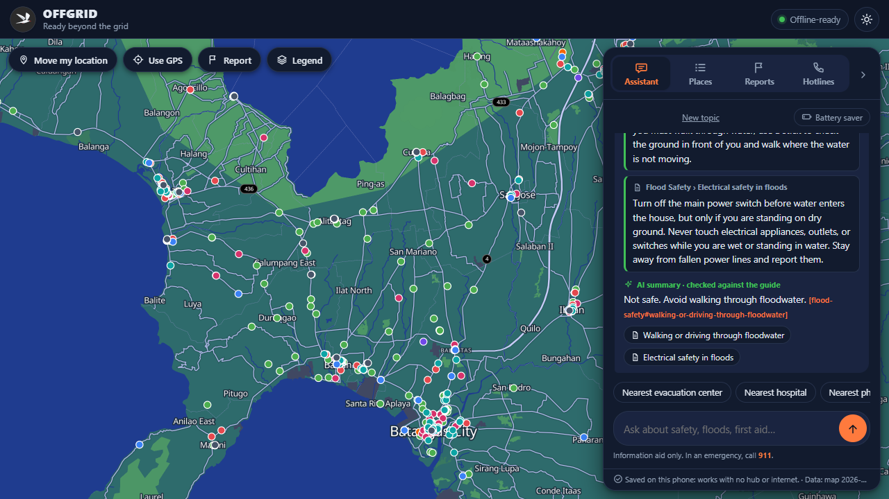
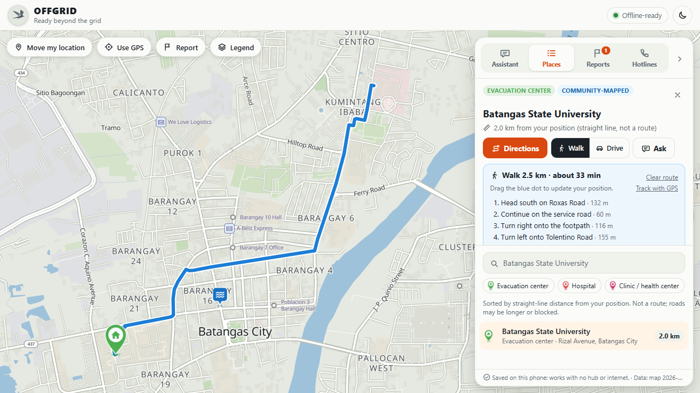
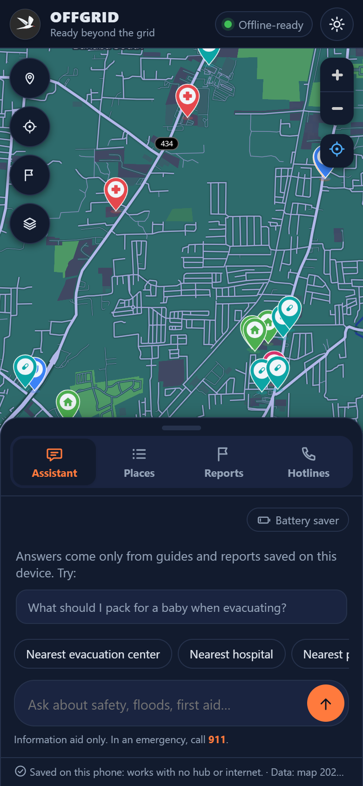
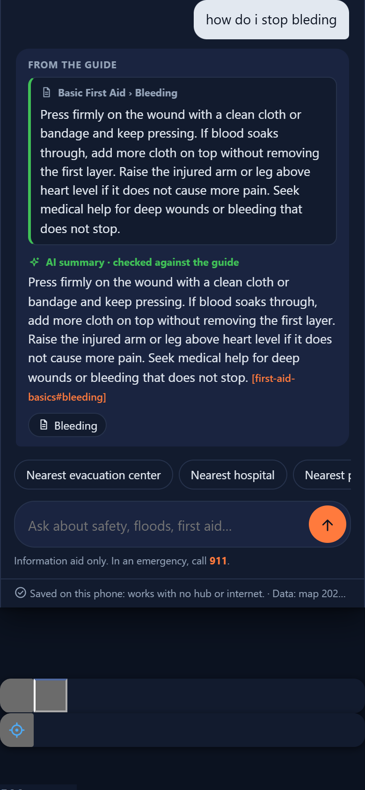
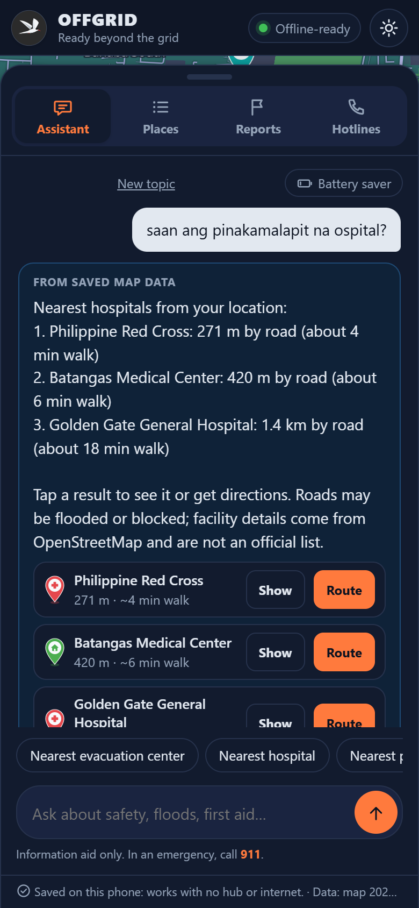
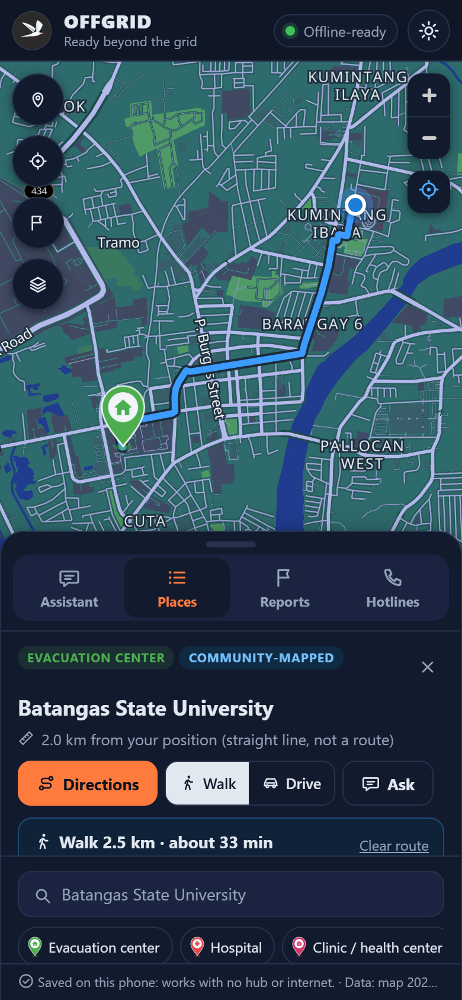
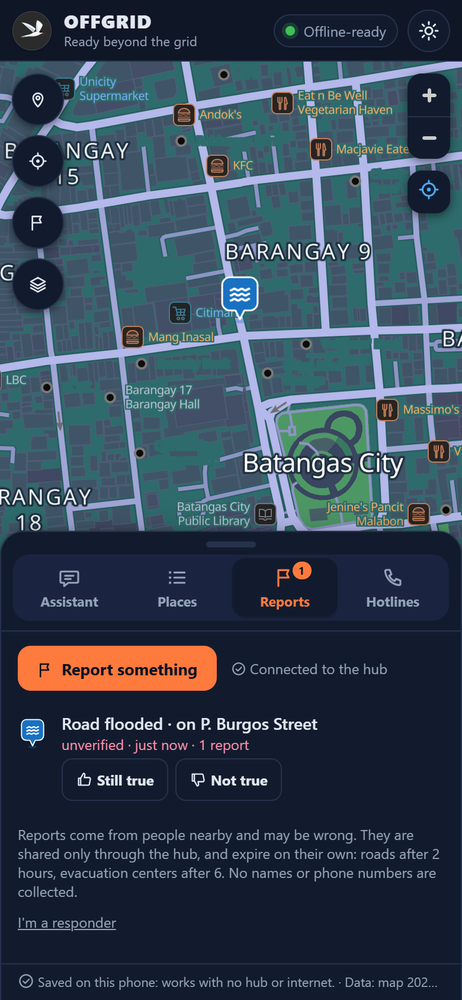
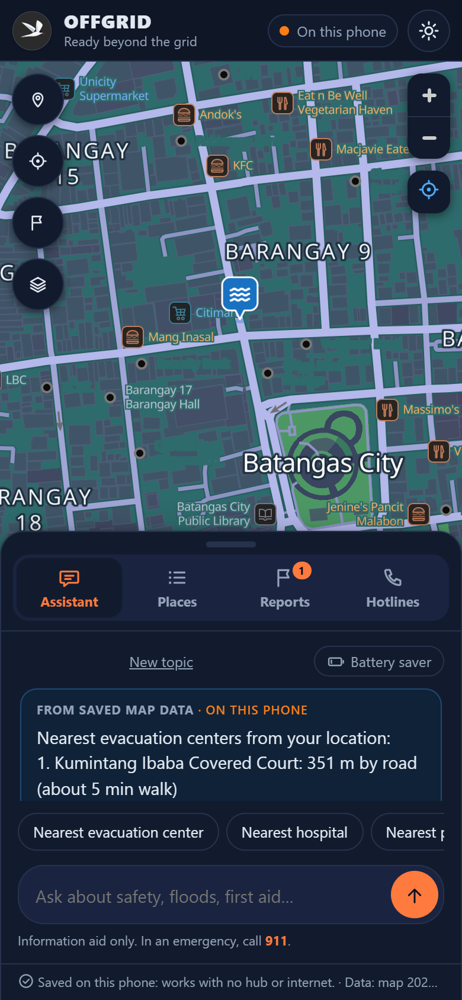
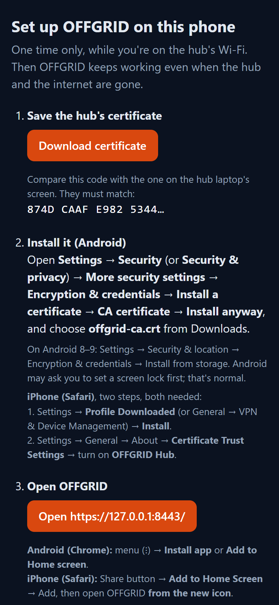

<p align="center">
  
</p>

<h1 align="center">OFFGRID</h1>
<p align="center"><b>Ready beyond the grid.</b><br>
An offline emergency map and AI assistant for all of Batangas, Philippines.</p>

OFFGRID keeps working when the power and the internet are gone. A laptop runs a small AI model **locally** (no cloud) and acts as a **hub** for the neighborhood. Phones connect to it over local Wi-Fi once, save a full offline copy, and from then on keep working **on their own**, even when the hub is switched off.

> **Information aid only.** OFFGRID does not replace official alerts, emergency services or local authorities. In an emergency, call **911**.
> Facilities come from OpenStreetMap (community-mapped, **not an official government list**). Hotlines come from official sources. Some guide sections are still drafts (see [Data and sources](#data-and-sources)).

**Watch the 1-minute demo:** [docs/demo_video.mp4](docs/demo_video.mp4) (55 s, recorded from the real app with the internet blocked).

---

## Contents
- [What it does](#what-it-does)
- [Screenshots](#screenshots)
- [How it works](#how-it-works)
- [Setup, step by step](#setup-step-by-step)
  - [A. Laptop hub (one time, while online)](#a-laptop-hub-one-time-while-online)
  - [B. Start OFFGRID](#b-start-offgrid)
  - [C. Put the laptop and the phones on one network](#c-put-the-laptop-and-the-phones-on-one-network)
  - [D. Android phone (Chrome)](#d-android-phone-chrome)
  - [E. iPhone (Safari)](#e-iphone-safari)
  - [F. Check that the phone works without the hub](#f-check-that-the-phone-works-without-the-hub)
  - [G. Troubleshooting](#g-troubleshooting)
- [Using OFFGRID](#using-offgrid)
- [For developers](#for-developers)
- [Data and sources](#data-and-sources)
- [Known limits](#known-limits)

---

## What it does

| Feature | What you get |
|---|---|
| **Offline map** | Street-level map of all of Batangas with 1,758 facilities: evacuation centers, hospitals, clinics, pharmacies, police, fire, rescue, town halls. Light and dark themes. |
| **Local AI assistant** | Answers from saved emergency guides. The **exact guide text comes first**; then the local AI (Qwen 2.5, 3B, via Ollama) adds a short summary. Code checks every number, phone number and name in that summary against the guide, and drops the summary if anything doesn't match. |
| **Understands typos and Taglish** | "how do i stop bleding", "is it safe to wlak thru flood water", "saan ang pinakamalapit na ospital" all work. Spelling is fixed by code before the search, on the laptop and on the phone. |
| **Nearest places, by road** | "Nearest hospital?", "Saan may botika?", "How far is it?". Answered from the map data, never invented by the AI. |
| **Offline directions** | Walking or driving routes with turn-by-turn steps and GPS tracking, computed on the device. Routes **steer around roads people reported as flooded or blocked**. |
| **Situation reports** | Anyone can report a flooded or blocked road, a full or open evacuation center, drinking water, a power outage or a medical need. Reports are labelled *unverified*, *confirmed* or *verified by a responder*, and expire on their own. No names or phone numbers are collected. |
| **Hotlines** | Official numbers: national, Batangas PDRRMO, Batangas City, Lipa City. |
| **Battery saver** | Skips the AI and shows the guide text only. It turns on by itself at 20% battery when not charging. |
| **Works with the hub off** | Each phone keeps the map, guides, hotlines, search, nearest places and the router (about 46 MB). Only the AI summary and live report sharing need the hub. |

---

## Screenshots

All screenshots come from the real app, taken by [`tools/screenshots.mjs`](tools/screenshots.mjs) with the internet blocked.

**Laptop (the hub)**

| Dark map: the local AI answers a typo'd question | Light map: walking directions to an evacuation center |
|---|---|
|  |  |
| "is it safe to wlak thru flood water?": guide text first, then an **AI summary · checked against the guide**. | A 2.5 km walking route with turn-by-turn steps. The flood icon is a road report. |

**Phone**

| Home | Assistant (typo on purpose) | Nearest, in Filipino |
|---|---|---|
|  |  |  |
| Full-screen map; the panel is a bottom sheet you drag up and down. | "how do i stop bleding" finds **Basic First Aid › Bleeding**. | "saan ang pinakamalapit na ospital?" lists hospitals by road distance, with Show and Route buttons. |

| Directions | Situation reports | Hub switched off |
|---|---|---|
|  |  |  |
| Walking route computed by the router. | Another phone reported **Road flooded · on P. Burgos Street**; it shows here as *unverified* until others confirm it. | The hub is off: the pill says **On this phone** and answers still come, from the phone's saved copy. |

| Hub setup page (what a phone sees first) |
|---|
|  |
| The hub's `/setup` page: download the certificate, compare its code, install it, open OFFGRID. (Here the address is `127.0.0.1` because it was taken on the laptop; on a phone it shows the laptop's Wi-Fi address.) |

---

## How it works

```
                 LAPTOP  =  HUB  (optional)                         PHONES
   ┌──────────────────────────────────────────────┐   local Wi-Fi   ┌───────────────────────────┐
   │ FastAPI server (Python)                      │ ◀────────────▶ │ OFFGRID app (installed     │
   │  • local AI: Ollama + qwen2.5:3b (no cloud)  │   https :8443   │ from the hub, works alone) │
   │  • guide search (BM25) + spelling fixer      │                 │  • map + 1,758 places      │
   │  • code check of every AI summary            │  setup page     │  • guides + same search    │
   │  • road router (A*), avoids reported roads   │   http :8080    │  • router on the phone     │
   │  • situation reports (SQLite)                │                 │  • reports outbox + copy   │
   └──────────────────────────────────────────────┘                 └───────────────────────────┘
        No internet needed after setup.                 Hub off?  The phone keeps working.
```

- **Order of an answer:** location questions ("nearest hospital", "how far") and current-conditions questions ("is the road flooded?") are answered from data, never by the AI. Direction questions go to the router. Everything else searches the guides; if nothing matches, OFFGRID says so instead of guessing. The AI only ever sees the guide sections shown on screen.
- **The phone engine** in `app/static/offline/` is a JavaScript port of the hub's search, spelling fixer, answers and router. Parity tests check that it gives the same answers as the hub.
- **Reports are shared only through the hub.** A phone that is offline keeps its reports in an outbox and sends them when it next reaches the hub.

---

## Setup, step by step

You need:
- **Laptop (hub):** Windows 10 or 11, about 8 GB RAM, about 3 GB free disk (most of it is the AI model). Wi-Fi, or a router shared with the phones.
- **Phones:** Android 8 or newer with Chrome (about 60 MB free, 2 GB RAM), or an iPhone with Safari.
- **Internet only once,** on the laptop, to install the software and download the AI model.

### A. Laptop hub (one time, while online)

1. **Install the tools:**
   - [Python 3.12 or newer](https://www.python.org/downloads/). Tick **"Add python.exe to PATH"** in the installer.
   - [Git for Windows](https://git-scm.com/download/win). OFFGRID uses its `openssl` to make the hub's certificate.
   - [Ollama](https://ollama.com/download), which runs the local AI.
2. **Copy the OFFGRID folder** to the laptop, for example to the Desktop.
3. **Open PowerShell in that folder:** in File Explorer, open the folder, click the address bar, type `powershell` and press Enter.
4. **Create the Python environment and install the packages:**
   ```powershell
   python -m venv .venv
   .venv\Scripts\python -m pip install -r requirements.txt
   ```
5. **Download the AI model** (about 1.9 GB):
   ```powershell
   ollama pull qwen2.5:3b
   ```
6. **Optional check:** `.venv\Scripts\python -m pytest -q` should end with "passed".

From here on, the laptop needs **no internet**.

### B. Start OFFGRID

| You want | Double-click | Then |
|---|---|---|
| Use it on **this laptop only** | `start.bat` | The app opens at http://127.0.0.1:8000. Close the "OFFGRID server" window to stop. |
| Let **phones** connect (hub mode) | `start_hub.bat` | Two "OFFGRID hub" windows open (https 8443 for phones, http 8080 for the setup page). Close both to stop. |

When `start_hub.bat` is ready, it prints what each phone needs:

```
[OK] Hub running. On each phone, join this laptop's Wi-Fi or hotspot and open:
       http://192.168.1.26:8080/setup

     Certificate code the phone must show (compare the first 16 characters):
       874D CAAF E982 5344
```

Your address and code will be different. Keep this window where people can see it. The status pill in the app turns green, **Offline-ready**, once the AI model is loaded.

- The AI is optional in hub mode. If Ollama isn't running, answers show the guide text without the AI summary.
- **Responder PIN:** the "OFFGRID hub - phones (https 8443)" window prints `responder PIN for this session: ......`. Give it only to barangay responders; it lets them verify or remove reports. To choose your own PIN, set `BB_RESPONDER_PIN` before starting.

### C. Put the laptop and the phones on one network

Use **one** of these:

1. **Same Wi-Fi router** (home, barangay hall, school). It works even when the router has no internet, as long as it has power.
2. **The laptop's Mobile Hotspot:** Windows **Settings → Network & internet → Mobile hotspot → On**. Phones join that network; the setup address is then usually `http://192.168.137.1:8080/setup`.
3. **A phone's hotspot:** the laptop and the other phones join it. Restart `start_hub.bat` afterwards so it prints the new address.

The first time, **Windows Firewall asks whether Python may use the network.** Allow it. If the laptop's network is marked *Public*, the phones may not be able to reach it. Either set that network to **Private** (Settings → Network & internet → Wi-Fi → your network → Private network) or allow Python on Public networks too.

### D. Android phone (Chrome)

Do this once per phone, while near the hub. It takes about 2 minutes.

1. Connect the phone to the same network as the laptop (step C).
2. Open **Chrome** and type the setup address the hub printed, for example `http://192.168.1.26:8080/setup`.
3. Tap **Download certificate**. Check that the code on the page matches the code on the laptop screen.
4. **Install the certificate:** Settings → **Security** (or Security & privacy) → More security settings → **Encryption & credentials** → **Install a certificate** → **CA certificate** → Install anyway, and choose `offgrid-ca.crt` from Downloads.
   - Android 8–9: Settings → Security & location → Encryption & credentials → **Install from storage**.
   - Android may ask you to set a screen lock first. That is normal.
5. Back on the setup page, tap **Open https://…:8443/**. The OFFGRID app opens with no security warning.
6. In Chrome's menu (⋮), tap **Install app** (or **Add to Home screen**).
7. Wait until the bottom of the app says **"Saved on this phone: works with no hub or internet."** About 46 MB is saved.
8. From now on, open OFFGRID **from its home-screen icon**.

**Why the certificate?** Phones allow offline copies and GPS only on secure (https) pages. The hub makes its own small certificate authority. It is limited to private network addresses, so it cannot be used to fake real websites. You can remove it later in the same Settings screen.

### E. iPhone (Safari)

The steps are written but **not yet tested on a real iPhone.**

1. Connect the iPhone to the same network as the laptop (step C).
2. Open **Safari** (not Chrome) and type the setup address, for example `http://192.168.1.26:8080/setup`.
3. Tap **Download certificate**, then **Allow**. Check that the code matches the laptop screen.
4. Two settings, **both needed:**
   1. Settings → **Profile Downloaded** (or General → VPN & Device Management) → **Install**.
   2. Settings → General → About → **Certificate Trust Settings** → turn on **OFFGRID Hub**.
5. Back in Safari, tap **Open https://…:8443/**.
6. Tap the **Share** button → **Add to Home Screen** → **Add**.
7. Open OFFGRID **from the new icon** (not from Safari), and wait for **"Saved on this phone"**.

### F. Check that the phone works without the hub

1. On the laptop, close the two "OFFGRID hub" windows (or switch the laptop off).
2. On the phone, open OFFGRID from the home-screen icon. The pill now says **On this phone**.
3. Try these:
   - Ask "nearest evacuation center". You should get a list with road distances.
   - Ask "how do I stop bleeding". You should see the first-aid guide text.
   - Open **Places**, pick a place, tap **Directions**. A route should appear on the map.
4. Start the hub again later. The phone shares its queued reports and picks up new ones automatically.

### G. Troubleshooting

| Problem | What to do |
|---|---|
| **The phone can't open the setup address** | Check the hub windows are open and the address is exactly what `start_hub.bat` printed (`http`, port `8080`). Make sure both devices are on the same network. Allow Python in Windows Firewall (step C). Some routers block devices from seeing each other ("AP isolation" or "client isolation", common on guest Wi-Fi); use the laptop's Mobile Hotspot or a phone hotspot instead. Antivirus firewalls can also block Python; allow it there too. |
| **"Your connection is not private"** | The certificate isn't installed or trusted yet. Repeat step D4 (Android) or both settings in step E4 (iPhone). |
| **No "Install app" in Chrome's menu** | Open the **https** address (port 8443), not the setup page. Reload once after the certificate is installed. |
| **Stuck on "Saving…"** | Stay near the hub with the app open until it says "Saved on this phone". About 46 MB is downloaded. |
| **The laptop's address changed** | Restart `start_hub.bat`. It renews the hub certificate for the new address and prints it. The phone keeps its certificate, but needs to open and install the app from the new address. |
| **"AI offline" or no AI summary** | Start Ollama (the tray app, or `ollama serve`). Answers still work from the guide text. |
| **"Model missing"** | While online: `ollama pull qwen2.5:3b`. |
| **The first answer is slow** | The model is loading into memory. Wait for **Offline-ready** and close other heavy apps. |

---

## Using OFFGRID

- **Top bar:** the status pill (*Offline-ready*, *AI warming up*, *AI offline*, or *On this phone* when there is no hub) and the light/dark toggle.
- **Map buttons:** *Move my location* (tap the map where you are), *Use GPS* (zooms to you), *Report*, *Legend*. The compass appears when the map is rotated; tap it to face north again.
- **Panel tabs** (a floating card on the laptop, a bottom sheet on phones):
  - **Assistant:** ask anything. Tap a suggestion chip or type. *New topic* clears the follow-up context. *Battery saver* skips the AI.
  - **Places:** search and filter facilities, tap one for details, **Directions** (Walk or Drive), or **Ask** about it.
  - **Reports:** **Report something**, choose what, tap the spot on the map. Others can tap **Still true** or **Not true**. *I'm a responder* takes the hub PIN.
  - **Hotlines:** official emergency numbers.

**Questions to try**

| Ask | You get |
|---|---|
| "Nearest evacuation center" / "saan ang pinakamalapit na ospital?" | The 3 nearest by road, with Show and Route buttons |
| "How do I get there?" (after picking a place) | Turn-by-turn directions |
| "Is it safe to walk through floodwater?" | Flood-safety guide text plus a checked AI summary |
| "What should I pack for a baby when evacuating?" | When to evacuate, plus the go-bag section for infants |
| "Is the road flooded?" / "Any reports near me?" | Current situation reports, with their trust labels and age |
| "What does signal no. 3 mean?" | PAGASA wind signals (the verified section) |
| "Batangas PDRRMO number" | Official hotline |

The full question bank, with what answers each one, is in [data/suggested_questions.md](data/suggested_questions.md).

**Report kinds and how long they last:** road flooded or blocked (2 h); evacuation center full or open (6 h); drinking water (6 h); power out (6 h); medical need (2 h). A confirmation restarts the clock, up to 3 lifetimes. A report gets the *confirmed* label after 2 confirmations, and is hidden when disputes reach confirmations + 2. Limits: 10 reports per phone and 30 per network address per hour.

---

## For developers

**Tests**
```powershell
.venv\Scripts\python -m pytest -q          # Python and Node parity tests; no Ollama needed (the AI is mocked)
node tools\e2e_offline.mjs                 # headless Edge: save the copy, stop the hub, check everything still works
.venv\Scripts\python tools\check_questions.py        # 220-question bank -> docs/question_report.md
.venv\Scripts\python tools\check_questions.py --ai --sample 40   # also check real AI summaries
node tools\screenshots.mjs                 # retake the README screenshots (Ollama running)
```

**After changing data or app code,** rebuild the phone pack so phones download the new copy next time they reach the hub:
```powershell
.venv\Scripts\python tools\build_phone_pack.py
```
After changing answer logic, also run `.venv\Scripts\python tools\make_parity_fixtures.py`.

**Where things are**

| Path | What |
|---|---|
| `app/main.py`, `app/config.py` | FastAPI app and settings (env overrides: `BB_MODEL`, `BB_THRESHOLD`, `BB_TOP_K`, `BB_REPORTS_DB`, `BB_RESPONDER_PIN`, …) |
| `app/routes/` | `assistant.py` (answers), `directions.py`, `reports.py`, `locations.py`, `setup.py` |
| `app/services/` | `retrieval.py` (BM25 + synonyms), `normalize.py` (spelling fixer), `intents.py`, `verify.py` (AI summary check), `routing.py` (A*), `reports.py`, `llm.py` (Ollama) |
| `app/static/` | The web app (vanilla JS, MapLibre, PMTiles) and `sw.js`, the offline copy |
| `app/static/offline/` | The phone engine: search, spelling fixer, answers, router, reports |
| `data/` | Facilities, guides, roads, question bank |
| `tools/` | Imports, phone pack, certificates, map styles, demo and screenshot tools |
| `tests/` | pytest suite, question bank, JS parity tests |

**API**

| Endpoint | Purpose |
|---|---|
| `GET /api/health` | Server, Ollama and model status, report count |
| `GET /api/locations`, `GET /api/locations/{id}` | Facility records |
| `POST /api/assistant/ask` | `{question, location_id?, previous?, from_pos?, travel_mode?, use_ai?}` → NDJSON stream |
| `GET /api/route` | `from_lat, from_lng, to_id, mode=walk\|drive, avoid_reports=true` → line, steps, distance, time, avoided reports |
| `GET /api/hotlines` | Hotline sections |
| `GET/POST /api/reports`, `POST /api/reports/{id}/vote` | List, post and confirm/dispute situation reports |
| `POST /api/reports/responder`, `POST /api/reports/{id}/verify`, `DELETE /api/reports/{id}` | Responder sign-in (PIN), verify, remove |
| `GET /setup`, `GET /offgrid-ca.crt` | Phone setup page and the hub certificate |

---

## Data and sources

### Facilities: `data/locations.json` (1,758 records, all of Batangas)
Imported from **OpenStreetMap** (© OpenStreetMap contributors, ODbL) on 2026-10-09 by `tools/import_osm.py`:

| Type | Count | OSM tags |
|---|---|---|
| Evacuation center | 183 | `evacuation_center=yes` / `emergency_shelter=yes` (schools, BatStateU, town halls, gyms) |
| Pharmacy | 317 | `amenity=pharmacy`, `shop=chemist` |
| Clinic / health center | 256 | `amenity=clinic`/`doctors`, `healthcare=centre` |
| Hospital | 101 | `amenity`/`healthcare=hospital` |
| Town / city hall | 68 | `amenity=townhall` (not barangay) |
| Police / fire | 85 / 39 | `amenity=police` / `fire_station` |
| Rescue / DRRM | 14 | Ambulance and rescue stations, DRRM offices |
| Barangay hall | 467 | `townhall:type=barangay/village` (hidden by default) |
| Market / grocery | 228 | Supermarkets, groceries, marketplaces (hidden by default) |

- **These are not official designations.** Evacuation centers show "Confirm with your barangay or MDRRMO".
- Point/outline duplicates were merged (26), and unnamed objects dropped (34).
- **Gaps:** OSM has no drinking-water points mapped in this area. Sari-sari stores (1,800+) are excluded on purpose.
- To refresh, while online: `.venv\Scripts\python tools\import_osm.py`.

### Hotlines: `data/guides/hotlines.md`
Copied on 2026-10-09 from:
- **National numbers:** DZRH News list, 7 Jan 2026
- **Batangas PDRRMO:** [portal.batangas.gov.ph/contact-us](https://portal.batangas.gov.ph/contact-us/)
- **Batangas City:** [batangascity.gov.ph](https://www.batangascity.gov.ph/web/cdrrmoprofile)
- **Lipa City:** [lipa.gov.ph/for-residents](https://lipa.gov.ph/for-residents/)

Each section names its source. Other towns have no verified list yet.

### Roads: `data/roads.json.gz`
19,325 km of OpenStreetMap roads and paths (158k junctions), imported 2026-10-09 by `tools/import_roads.py`. If the file is missing, the app still runs without directions.

### Guides: `data/guides/*.md`
Six guides: typhoon preparation, flood safety, first aid, go bag, power outage, hotlines. Each `##` section is a citable chunk.
- The PAGASA **wind signal** section was checked against PAGASA's official TCWS table (press release, 23 Mar 2022).
- The other sections are **drafts** of general guidance. Check them against NDRRMC, DOH and Philippine Red Cross material before real use.

### Map assets (all local)

| File | Origin |
|---|---|
| `app/static/map/area.pmtiles` | Protomaps basemap extract, z0–15, 32 MB, 2026-10-08 build. Bbox 120.55, 13.45 – 121.50, 14.20 (all of Batangas) |
| `app/static/map/style.json`, `style-dark.json` | Generated by `tools/make_style.mjs` (`@protomaps/basemaps@5.7.2`): light "Soft Sage" and dark palettes |
| `app/static/map/fonts/`, `sprites/` | Noto Sans glyphs (SIL OFL) and sprites from `protomaps/basemaps-assets` |
| `app/static/vendor/` | MapLibre GL JS 5.6.0 (BSD-3), PMTiles JS (BSD-3) |

Map data © OpenStreetMap contributors (ODbL), © Protomaps. Local AI: [Qwen 2.5 3B](https://ollama.com/library/qwen2.5) through Ollama.

---

## Known limits

- **Guides are mostly drafts.** Only the wind-signal section is verified.
- **Facility data is community-mapped,** not an official list, and may be out of date.
- **Routes and reports can be wrong or missing.** Every route says so: OFFGRID only knows about the floods and closures people reported.
- **Not yet tested on a real phone.** It has been tested in phone-sized browser windows; a real Android phone and a real iPhone are next.
- **AI summaries are most reliable in English.** For Filipino questions the guide text is always shown.
- **Content gaps:** earthquake and Taal Volcano guides, the official LGU evacuation list, and hotlines for towns other than Batangas City and Lipa.
